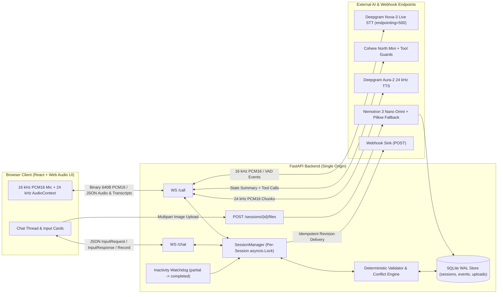

# Multichannel Voice + Chat Insurance Claims Agent

Full-duplex voice and web chat agent built for motor insurance claim intake. The system synchronizes state in real time across a browser voice call (`WS /call`) and an interactive chat thread (`WS /chat`), normalizes and validates inputs deterministically on the server, resolves cross-channel conflicts, and delivers an idempotent, revision-tracked `FinalRecord`.

**Live Deployed URL:** `https://<YOUR-DEPLOYED-URL>`

---

## 1. Architecture & Cross-Channel State Synchronization



### How State Is Shared Across Channels
Both `WS /call?sessionId={id}` and `WS /chat?sessionId={id}` attach to a centralized `SessionManager` backed by a SQLite database in Write-Ahead Logging (`WAL`) mode (`backend/app/store.py`). Every mutation acquires a per-session `asyncio.Lock` and commits atomically to disk before emitting wire events:

1. **Call $\rightarrow$ Chat Card Dispatch (Sequenced Handoff):** As the user speaks on the call (`incidentDescription`, `incidentLocation`, `incidentTime`, `injuries`, `vehicleDrivable`), `cohere/north-mini-code:free` invokes `record_spoken_fields`. While all 5 spoken fields are still being collected, structured chat cards (`policyNumber`, `vehicleType`, `email`, `damagePhotos`, `confirmSubmit`) are held in `next_missing_input_request(call_active=True)`. Once all 5 spoken fields validate, `VoicePipelineSession` enters `_closing_handoff`, finishes streaming and draining the full goodbye audio playback (`_last_tts_bytes / 48000.0 - _last_tts_play_elapsed_s + 1.5s`) before closing `/call`, and then dispatches the first structured chat card so the user finishes cleanly in chat.
2. **Chat $\rightarrow$ Call Live Acknowledgment:** When the user submits a chat card during an active call, `handle_chat_message` validates the value, persists it with `source="chat"`, dispatches the next chat card, and notifies the active `VoicePipelineSession`. If the voice agent is idle, it immediately speaks a confirmation (e.g., *"Got your policy number POL-123456. I've sent the vehicle selector to your chat."*); if the agent is mid-turn, the acknowledgment is queued and spoken as soon as the turn finishes.
3. **Spoken Input Cancels Open Chat Card (`inputCancel`):** If an optional card (`email`) or `policyNumber` is open in `/chat` and the user speaks a valid value on `/call`, the backend persists the spoken value and emits `{"type": "inputCancel", "requestId": "req_email", "reason": "given on the call"}` over `/chat` to dismiss the card.
4. **Call Hang-Up $\rightarrow$ Chat Continuation & Call Resume:** When `/call` disconnects before completion, `_nudge_chat_after_call` sends a transition message on `/chat` and dispatches `inputRequest` cards for any remaining spoken or chat fields. If the user clicks **Call** again later, `speak_context_greeting` summarizes already-collected fields from SQLite and resumes without repeating answered questions.

### LLM-Driven Conversation Without Over-Determinism
A common pitfall with tool-calling voice agents is either trusting small free-tier LLMs blindly (causing overwritten fields or hallucinated `"none"` / `true` defaults) or replacing the LLM with a rigid script. We kept the conversation **genuinely LLM-driven** (`cohere/north-mini-code:free`, `temperature=0.0`, 10-turn rolling context) while adding narrow safety guards in [`backend/app/voice.py`](backend/app/voice.py):
* **Natural Turn Order & Multi-Field Capture:** Callers can give details in any order, combine multiple facts in one sentence, ask clarifying questions, or pause mid-thought (`endpointing=500`, `utterance_end_ms=1000` on Deepgram Nova-3).
* **Malformed Tool JSON Recovery (`_parse_tool_args`):** Repairs duplicate commas (`,,`) or stray brackets emitted by small models instead of dropping extracted arguments.
* **Grounded Field Extraction (`_is_spoken_field_grounded`) & Overwrite Lock:** Prevents unmentioned `injuries` or `vehicleDrivable` guesses and locks already-valid `source="call"` fields while moving on — while **still allowing legitimate updates** when `last_prompt` explicitly targeted that field or the user uses correction phrasing (`"actually"`, `"correction"`, `"sorry"`, `"meant to say"`, `"instead"`, `"change my"`, `"wrong"`).
* **Question-Reactive Recovery (`_recover_direct_prompt_answer`):** Never enforces a fixed question order; activates *only* when the assistant's immediate `last_prompt` explicitly asked about `vehicleDrivable` or `injuries`, the model omitted the tool call on a short direct answer (e.g., `"Yes."`), and `validate_field()` cleanly validates it.
* **Fast Vision Check & Actionable Review Notes:** [`backend/app/vision.py`](backend/app/vision.py) downscales uploads (`MAX_IMAGE_DIM=512`), JPEG-encodes (`quality=85`), disables reasoning tokens (`reasoning={"effort": "none"}`) on `nvidia/nemotron-3-nano-omni-30b-a3b-reasoning:free` over a pooled HTTP client, posts a brief damage assessment directly into `/chat`, and degrades cleanly to local Pillow checks on upstream timeout/`429`. When a claim escalates to `needsReview` (bodily injury or 3-strike validation failure), `_maybe_send_needs_review_note` posts a plain explanation alongside `FinalRecord`.

---

## 2. Final Record Schema, Sanitization & Conflict Resolution

### Final Record JSON Schema
```json
{
  "sessionId": "s_7f3a",
  "revision": 1,
  "outcome": "completed | partial | optedOut | needsReview",
  "outcomeReason": "All required claim fields validated and confirmed by user",
  "fields": {
    "incidentDescription": {"value": "Rear-ended by a truck at a signal", "source": "call", "collectedAt": "2026-11-11T10:02:11+05:30", "status": "valid"},
    "incidentLocation": {"value": "MG Road, Bengaluru", "source": "call", "collectedAt": "2026-11-11T10:02:24+05:30", "status": "valid"},
    "incidentTime": {"value": "2026-11-11T08:00:00+05:30", "source": "call", "collectedAt": "2026-11-11T10:02:35+05:30", "status": "valid"},
    "injuries": {"value": "none", "source": "call", "collectedAt": "2026-11-11T10:02:48+05:30", "status": "valid"},
    "vehicleDrivable": {"value": true, "source": "call", "collectedAt": "2026-11-11T10:02:55+05:30", "status": "valid"},
    "policyNumber": {"value": "POL-123456", "source": "chat", "collectedAt": "2026-11-11T10:03:15+05:30", "status": "valid"},
    "vehicleType": {"value": "car", "source": "chat", "collectedAt": "2026-11-11T10:03:25+05:30", "status": "valid"},
    "email": {"value": "asha.rao@example.com", "source": "call", "collectedAt": "2026-11-11T10:03:40+05:30", "status": "valid"},
    "damagePhotos": {"value": ["http://localhost:8080/files/s_7f3a/d1.png"], "source": "chat", "collectedAt": "2026-11-11T10:04:02+05:30", "status": "valid"},
    "confirmSubmit": {"value": true, "source": "chat", "collectedAt": "2026-11-11T10:04:10+05:30", "status": "valid"}
  },
  "conflicts": [
    {
      "field": "policyNumber",
      "callValue": "POL-111111",
      "chatValue": "POL-123456",
      "resolution": "chatValue",
      "reason": "Typed or uploaded chat input preferred over spoken ASR transcript"
    }
  ],
  "engagement": {"calls": 1, "callSeconds": 118, "chatMessages": 5},
  "costUsd": 0.0162,
  "endedAt": "2026-11-11T10:04:10+05:30"
}
```

### Field Validation & Normalization Rules (`backend/app/validator.py`)

| # | Field | Primary Channel | Required | Normalization & Deterministic Validation Rule |
|---|---|---|---|---|
| 1 | `incidentDescription` | Call (or Chat fallback) | Yes | Collapse whitespace; valid if $\ge 10$ chars and $\ge 2$ words. |
| 2 | `incidentLocation` | Call (or Chat fallback) | Yes | Collapse whitespace; valid if $\ge 3$ chars. |
| 3 | `incidentTime` | Call (or Chat fallback) | Yes | Parses ISO-8601 or natural expressions (`"today at 9:30am"`, `"yesterday morning"`, `"2 hours ago"`) into `Asia/Kolkata` (`+05:30`) ISO-8601. Rejects future timestamps ($> \text{now} + 5\text{m}$) or $> 365$ days ago. |
| 4 | `injuries` | Call (or Chat fallback) | Yes | Normalizes `"no"`, `"none"`, `"nobody"`, `"no one hurt"` $\rightarrow$ `"none"`. Any other value $\ge 3$ chars is valid and sets `injury_review_flag = True`. |
| 5 | `vehicleDrivable` | Call (or Chat fallback) | Yes | Normalizes `"yes"`/`"true"`/`"drivable"` $\rightarrow$ `True`; `"no"`/`"false"`/`"not drivable"`/`"towed"` $\rightarrow$ `False`. |
| 6 | `policyNumber` | Chat Card | Yes | Uppercases, strips spaces, and normalizes prefix hyphen (`"pol 123456"` $\rightarrow$ `"POL-123456"`). Must match `^POL-[0-9]{6}$`. |
| 7 | `vehicleType` | Chat Card (`select`) | Yes | Case-insensitive match mapped to `car`, `twoWheeler`, or `commercial`. |
| 8 | `damagePhotos` | Chat Card (`file`) | Yes | 1–5 URLs verified to belong to this `sessionId` in `uploads` table (validated for PNG/JPEG/WEBP/GIF magic bytes $\le 10\text{ MB}$ + vision check). |
| 9 | `email` | Chat Card or Call | **Optional** | Lowercased; spoken `" at "` / `" dot "` normalized on `source="call"`. Validated against RFC email regex, or `"skip"` / `""` marks optional field handled with `value: null`. |
| 10 | `confirmSubmit` | Chat Card (`confirm`) | Control | Dispatched only after fields 1–8 are valid. `True` finalizes session; `False` re-prompts once and triggers `optedOut` on second rejection. |

### Conflict Resolution Rules
When a field already has `status == "valid"` from `source_A` and receives a new valid value from `source_B` (`source_A != source_B`) where `normalized_new != existing_value`:
* **Structured Fields (`policyNumber`, `vehicleType`, `email`, `damagePhotos`):** `chatValue` always wins over `callValue` (`resolution="chatValue"`), preventing ASR transcription errors on alphanumeric strings.
* **Conversational Fields (`incidentDescription`, `incidentLocation`, `incidentTime`, `injuries`, `vehicleDrivable`):** Latest valid update wins, allowing the user to refine or correct their statement in a subsequent turn.
* All conflicts are appended to `state.conflicts` with `field`, `callValue`, `chatValue`, `resolution`, and `reason`.

---

## 3. Outcome Triggers, Delivery & Revision Lifecycle

| Outcome | Trigger Condition |
|---|---|
| **`completed`** | All 8 required fields have `status == "valid"`, `confirmSubmit == True`, and no `needsReview` flag is active. |
| **`partial`** | `/call` is disconnected and no `/chat` activity occurs for `PARTIAL_TIMEOUT_SECONDS` (default `120s`) while at least one required field is missing/invalid or unconfirmed. |
| **`optedOut`** | User explicitly cancels on the call (`opt_out_session` tool), submits `"cancel claim"` / `"opt out"`, or rejects `confirmSubmit` (`False`) twice. |
| **`needsReview`** | Triggered if: (a) any field fails validation $\ge 3$ consecutive times, (b) `injuries != "none"` upon final confirmation (bodily injury requires human adjuster review), or (c) uploaded damage photos fail vision verification twice. |

### Delivery & Revision Upgrades (`revision: 1 -> 2`)
* Every session starts at `revision = 0`, `delivered_revision = 0`.
* Reaching any outcome increments `revision += 1`, persists `FinalRecord` to SQLite, sends `{"type": "record", "record": ...}` over `/chat`, and calls `deliver_final_record()` (`backend/app/webhook.py`).
* `deliver_final_record()` checks `state.delivered_revision < record.revision`, prints a structured JSON record banner to stdout, POSTs the payload to `WEBHOOK_URL` (and `/api/webhook-sink`), and atomically updates `delivered_revision = record.revision` in SQLite. Server restarts never re-send an already delivered revision.
* **Resuming a `partial` Session:** If the inactivity watchdog emits `outcome="partial"` (`revision: 1`) and the user later returns to `/chat` or `/call` to finish the remaining fields and confirm, the session transitions to `completed` (or `needsReview`), increments to `revision: 2`, and delivers the updated record.

---

## 4. Stack Choice & Session Cost ($\le 150$ Words)

We built the backend on Python FastAPI and SQLite (`WAL` mode) with Deepgram Nova-3 (`endpointing=500`) for 16 kHz streaming STT, Deepgram Aura-2 (`aura-2-thalia-en`) for 24 kHz streaming PCM16 TTS, OpenRouter (`cohere/north-mini-code:free`) for natural tool-calling voice turns, and `nvidia/nemotron-3-nano-omni-30b-a3b-reasoning:free` (`effort="none"`, `MAX_IMAGE_DIM=512`) with Pillow fallback for damage-photo validation. Streaming raw PCM16 frames directly between browser and Deepgram eliminates server-side transcoding and preserves instant barge-in.

Out-of-pocket spend during development and live testing was **$0.00** using Deepgram free-tier credits and OpenRouter `:free` models. Based on live session telemetry (`state.cost_usd`) across verified ~49–63s calls:
* **Tracked Live Cost (~49–63s calls):** **`$0.0034–$0.0040`** per session (`$0.00` actual spend on free tiers)
* **Deepgram List Estimate (90s speech, 600 TTS chars):** **~$0.0155** (`$0.0065` STT + `$0.0090` TTS)
* **LLM + Vision (`:free`):** **$0.0000**

*(133 words)*

---

## 5. Product Decisions Where the Brief Was Open-Ended

1. **Collecting Full Context Before Escalating Bodily Injury (`needsReview`):** When a claimant reports an injury (`injuries != "none"`), aborting the call immediately forces a human adjuster to cold-call the user for basic policy and photo details. Instead, our agent flags `injury_review_flag = True`, collects all 8 required fields + confirmation, emits a clear `/chat` explanation note (`_maybe_send_needs_review_note`), and routes the completed packet to `needsReview`.
2. **Sequential Card Pacing During Voice Calls:** Rather than overwhelming a caller on a phone screen by rendering all chat cards at second zero, `next_missing_input_request(call_active=True)` holds structured cards until the 5 conversational fields are captured on the call, then plays the full goodbye message before closing `/call` and dispatching structured cards one at a time.
3. **Bypassing Browser Regex Blocking to Enforce Server-Side 3-Strike Escalation:** Auditing `starter/src/components/cards/Composer.tsx` and `answers.ts` revealed that setting `InputRequest.pattern` causes the browser to block invalid submissions locally before sending them over `/chat`. We intentionally omit `pattern` on `InputRequest` payloads so malformed inputs (e.g., `"POL-123"`) reach FastAPI, allowing deterministic server validation, `inputError` card re-opening, and 3-strike `needsReview` escalation.
4. **Configurable 120-Second `partial` Timeout:** Set via `PARTIAL_TIMEOUT_SECONDS=120` so reviewers can observe the `partial` (`revision: 1`) $\rightarrow$ `completed` (`revision: 2`) upgrade without waiting 30 minutes.

---

## 6. Edge Cases Handled vs. Known Limitations

### Edge Cases Handled
* **Server Restart Mid-Session:** All state, open card specs (`open_request`), failure counters, and revision watermarks live in SQLite WAL. Restarting `uvicorn` mid-session and refreshing the browser resumes on the exact pending field without re-asking prior fields or double-delivering webhooks.
* **Non-Clipping Call Handoff:** `_finish_call_after_speech` calculates remaining client buffer duration from streamed 24 kHz PCM bytes minus `_last_tts_play_elapsed_s` plus a `1.5s` safety buffer so the goodbye message finishes playing completely before `/call` closes and chat cards begin.
* **Mid-Sentence Barge-In:** Deepgram `SpeechStarted` events cancel active non-closing TTS `asyncio.Task`s and emit `{"type": "stopPlayback"}` on `/call`, halting browser playback immediately.
* **Small-Model Tool Quirks & Spoken Punctuation:** `_parse_tool_args` repairs minor JSON syntax glitches (`,,`, trailing brackets), `_is_spoken_field_grounded` + overwrite locks prevent hallucinated defaults or accidental field clobbering while still allowing spoken corrections, `_recover_direct_prompt_answer` catches dropped direct `"Yes."` / injury answers to an explicit assistant prompt without enforcing fixed turn order, and `validator.py` strips trailing ASR punctuation (`.!?,`) on yes/no responses.
* **Cross-Channel Concurrency Races:** Guarded by per-session `asyncio.Lock` instances in `SessionManager` so simultaneous `/call` tool updates, `/chat` submissions, and watchdog ticks never clobber state.
* **Fake Image Uploads & Upstream Vision 429s:** `POST /sessions/{id}/files` validates PNG/JPEG/WEBP/GIF magic bytes before touching disk. Images are downscaled (`MAX_IMAGE_DIM=512`), JPEG-encoded, and checked via `nvidia/nemotron-3-nano-omni-30b-a3b-reasoning:free` (`reasoning={"effort": "none"}`); if upstream returns `HTTP 429` or times out, [`vision.py`](backend/app/vision.py) degrades gracefully to local Pillow image verification so user uploads are never blocked.

### Known Limitations
* **Single-Node Process Locks & Rate Limiter:** Per-session `asyncio.Lock` objects and the IP sliding-window rate limiter reside in process memory (`--workers 1`). Horizontal multi-replica scaling would require Redis locks and counters.
* **Heuristic Relative Date Parser:** `_parse_incident_time()` deterministically resolves ISO dates and common relative phrases (`"today at 4pm"`, `"yesterday morning"`, `"2 hours ago"`), but complex regional phrasing (*"the Tuesday before last"*) requires clarification or falls back to chat.
* **English-Only ASR/TTS Configuration:** Configured for English (`nova-3`, `aura-2-thalia-en`); mid-call multilingual switching is not enabled in this build.

---

## 7. What in Our Own System We Trust Least (and Why)

1. **Free-Tier LLM Router Queue Jitter & Dropped Tool Calls (`backend/app/voice.py`):**
   * *Why:* Free OpenRouter endpoints share public queue capacity. Benchmarking `nvidia/nemotron-3.5-lightning:free` showed heavy latency spikes with `effort="minimal"`/`"low"` and dropped tool calls when reasoning was disabled (`effort="none"`), while `cohere/north-mini-code:free` performs much faster (~0.7–2.1s LLM inference) yet can still occasionally experience upstream queue jitter (~3–4s total turn latency) or omit a tool call on a terse `"Yes."` answer.
   * *Mitigation:* Temperature `0.0`, pooled keep-alive `httpx.AsyncClient`, `_parse_tool_args`, `_is_spoken_field_grounded`, and question-reactive `_recover_direct_prompt_answer` keep extraction reliable without hardcoding conversation order.
2. **Free-Tier Vision Latency & Rate Limits (`backend/app/vision.py`):**
   * *Why:* Sending full-resolution phone images to reasoning-enabled VL models originally caused long stalls; upstream `:free` rate limits (`HTTP 429`) can also occur under burst load.
   * *Mitigation:* Downscaling to `MAX_IMAGE_DIM=512` JPEG with `reasoning={"effort": "none"}` cut real damage-photo verification to ~1.9s, backed by deterministic Pillow fallback so uploads never hang.
3. **VAD Sensitivity vs. Turn Endpointing (`backend/app/voice.py`):**
   * *Why:* Using Deepgram `endpointing=500` avoids cutting callers off mid-thought while keeping `SpeechStarted` barge-in fast, but without headphones acoustic echo/noise spikes can still fire false barge-ins while the agent is speaking.
   * *Mitigation:* Barge-in is disabled during `_closing_handoff`, and cancelled turn text remains visible in the transcript thread.
4. **Regex-Based Natural Time Normalization (`backend/app/validator.py`):**
   * *Why:* Spoken timestamps are unconstrained; unusual phrasing that falls outside `_parse_incident_time()` patterns triggers a validation prompt and increments `failure_counts`.

---

## 8. Voice Latency, Vision Latency & Cost Measurements

### Live End-to-End Measurements (OpenRouter `:free` + Deepgram Free Tier)
Measured in [`VoicePipelineSession`](backend/app/voice.py) from finalized user speech (`_t_user_speech_end` in `_handle_final_transcript`) to the first 24 kHz PCM16 chunk written to `/call` (`t_first_sent`), across **17 conversational turns** from 3 live end-to-end voice+chat calls (`sessions.db`, excluding the initial `0.0 ms` welcome greeting):

| Metric | Observed Measurement | Notes / Scope |
|---|---|---|
| **Measured Voice Turn `p50` (`_t_user_speech_end` $\rightarrow$ `t_first_sent`)** | **2,142 ms** | Across 17 user turns (range `1,151 ms` – `3,949 ms`) |
| **Measured Voice Turn `p95`** | **2,964 ms – 3,949 ms** | Queue spikes on OpenRouter `:free` dominate tail latency |
| **LLM Inference (`cohere/north-mini-code:free`)** | **729 – 2,098 ms** | Observed per-turn `[TIMING]` logs (`llm_ms`) |
| **Deepgram Aura-2 TTS First Chunk (`aura-2-thalia-en`)** | **372 – 920 ms** | Observed per-turn `[TIMING]` logs (`tts_first_ms`) |
| **Vision Photo Check (`nvidia/nemotron-3-nano-omni-30b-a3b-reasoning:free`)** | **1,939 ms** (`679 ms` negative) | `MAX_IMAGE_DIM=512`, JPEG, `reasoning={"effort": "none"}` |
| **Offline Automated Test Suite (`pytest backend/tests/ -v`)** | **69 passed in 1.30s** | Uses offline mock STT/LLM/TTS + Pillow fallback |

*(Note: Adding Deepgram's `endpointing=500` silence threshold puts perceived end-to-end latency at ~2.6s median; switching `LLM_BASE_URL` / `LLM_MODEL` to a dedicated low-latency endpoint such as paid Groq/OpenRouter tiers drops LLM TTFT substantially without changing backend code.)*

### Cost Calculation Breakdown
Tracked live in `state.cost_usd` (`GET /sessions/{sessionId}/telemetry`):
* **Actual Out-of-Pocket Cost:** **`$0.00`** (built and validated entirely on OpenRouter `:free` models and Deepgram free-tier credits).
* **Tracked Meter Estimate (`49s–63s` live completed/review calls):** **`$0.0034–$0.0040`** per session.
* **Standard List-Rate Ceiling (90s speech, 600 TTS chars):** **~$0.0155** (`$0.0065` STT + `$0.0090` TTS + `$0.00` `:free` LLM/Vision).

---

## 9. What We Would Do Next With Another Week

> This working prototype was completed in roughly **1.5 days** using only free-tier models and APIs (**$0.00 spent out of pocket**). It already delivers a genuine, non-rigid voice + chat claims flow end to end, and can be made significantly more stable, lower-latency, and even smoother for end users going forward:

1. **Dedicated Low-Latency Inference Tiers:** Move off shared `:free` model queues to dedicated Groq / low-latency OpenRouter endpoints so voice turn `p95` drops reliably under `1,000 ms` and tool calls never experience router stalls.
2. **Token-Level Sentence Streaming into WebSocket TTS:** Stream LLM text tokens through a sentence-boundary buffer directly into Deepgram's persistent WebSocket TTS endpoint to shave another ~200–400 ms off voice response time.
3. **Interactive Chat Repair & Polish UX:** Let users edit previously submitted spoken/chat fields directly via inline edit pills in chat without needing to restart or phrase spoken corrections manually, plus show richer photo-upload progress feedback while vision runs.
4. **Acoustic Barge-In Debouncing:** Require either $\ge 150\text{ ms}$ of sustained VAD energy or a non-empty interim word token before firing `stopPlayback`, eliminating accidental background-noise interruptions when speakers aren't wearing headphones.
5. **Multilingual Code-Switching & Redis-Backed Scaling:** Enable Deepgram `multi` detection with regional TTS voice switching, and move per-session locks and rate limits to Redis for multi-worker horizontal scaling.

---

## 10. Where AI Coding Tools Helped vs. Where They Misled

* **Where AI Helped:**
  * Rapidly translating `starter/src/protocol/types.ts` and `enums.ts` into strict Pydantic v2 models (`ConfigDict(populate_by_name=True, extra="forbid")`) with 1:1 camelCase wire serialization.
  * Scaffolding the offline mock provider harness (`MockSTTProvider`, `MockLLMProvider`, `MockTTSProvider`), enabling `69` automated unit and integration tests (covering barge-in, 3-strike escalation, restart recovery, vision checks, and `revision: 1 -> 2` upgrades) to run deterministically in ~1.3s.
* **Where AI Misled (and Had to Be Verified Live):**
  1. **Assuming `:free` Reasoning Models Support Zero-Overhead Tool Calling Out of the Box:** Testing live against OpenRouter proved `nvidia/nemotron-3.5-lightning:free` still ran reasoning stalls under `effort="minimal"`/`"low"` and dropped tool calls under `effort="none"`. Benchmarking live turns led us to switch to `cohere/north-mini-code:free` and add narrow question-reactive recovery (`_recover_direct_prompt_answer`) rather than guessing flags blindly.
  2. **Client-Side `pattern` Trap:** Auditing `starter/src/components/cards/Composer.tsx` and `answers.ts#L50` showed that setting `pattern` on `InputRequest` blocks invalid submissions in the browser before they reach `/chat`, silently breaking server-side 3-strike `needsReview` escalation. Omitting `pattern` on server requests keeps validation server-authoritative.
  3. **`VITE_SERVER_URL=""` Empty-String Trap:** `starter/src/config.ts#L10` (`if (!raw) return null;`) treats an empty build string as *"No backend configured"*. Compiling a placeholder URL (`https://__RUNTIME_SERVER_HOST__`) and substituting `${PUBLIC_URL}` at container boot in `docker/entrypoint.sh` cleanly avoids hardcoding hosts at build time.
  4. **Premature Audio Hangup Cutoff:** Closing `/call` immediately when all 5 spoken fields validated caused client playback audio to truncate mid-goodbye; computing remaining PCM duration (`_last_tts_bytes / 48000.0 - _last_tts_play_elapsed_s + 1.5s`) before closing fixed the handoff cleanly.

---

## 11. Local Setup, Docker & Testing Endpoints

### Run Locally
```bash
# 1. Backend setup (from repository root)
python3 -m venv .venv && source .venv/bin/activate
pip install -r backend/requirements.txt
cp backend/.env.example backend/.env
# Add DEEPGRAM_API_KEY and OPENROUTER_API_KEY (or GROQ_API_KEY) to backend/.env
PYTHONPATH=. uvicorn backend.app.main:app --host 0.0.0.0 --port 8080

# 2. Frontend build (single-origin served by FastAPI at http://localhost:8080)
cd starter
npm install
VITE_SERVER_URL=http://localhost:8080 npm run build

# Or run Vite dev server separately in a second terminal:
cp .env.example .env.local   # Sets VITE_SERVER_URL=http://localhost:8080
npm run dev                  # Open http://localhost:5173
```

### Run via Single-Container Docker
```bash
docker build -t voice-chat-agent .
docker run --rm -p 8080:8080 \
  -e PUBLIC_URL=https://<your-deployed-host> \
  -e BASE_URL=https://<your-deployed-host> \
  -e DEEPGRAM_API_KEY=your_key \
  -e OPENROUTER_API_KEY=your_key \
  -e LLM_MODEL=cohere/north-mini-code:free \
  -e VISION_MODEL=nvidia/nemotron-3-nano-omni-30b-a3b-reasoning:free \
  voice-chat-agent
# For local Docker testing, use http://localhost:8080 for PUBLIC_URL and BASE_URL
```

### Run Offline Automated Test Suite
```bash
python -m pytest backend/tests/ -v
```

### HTTP Inspection & Testing Endpoints
* `POST /api/sessions` — Create a new session (`{"session_id": "..."}`).
* `POST /sessions/{sessionId}/files` — Upload a damage photo (`multipart/form-data`, `file`).
* `GET /sessions/{sessionId}/timeline` — Chronological audit log across `/call`, `/chat`, and `system` events.
* `GET /sessions/{sessionId}/telemetry` — Session `p50_latency_ms`, `p95_latency_ms`, `cost_usd`, and engagement counters.
* `GET /api/webhook-sink` — Inspect delivered `FinalRecord` revisions captured by the built-in webhook sink.