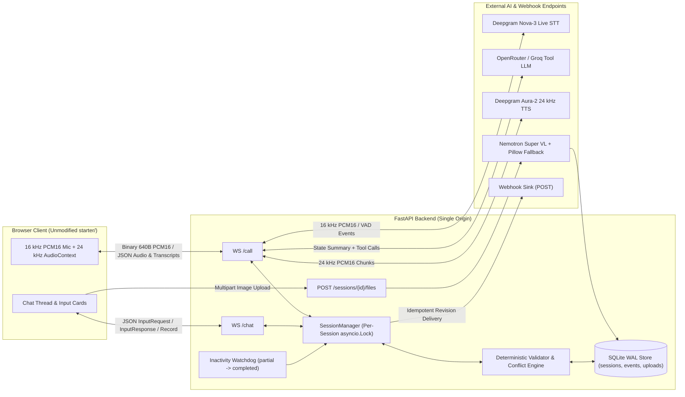

# Multichannel Voice + Chat Insurance Claims Agent

Full-duplex voice and web chat agent built for motor insurance claim intake. The system synchronizes state in real time across a browser voice call (`WS /call`) and an interactive chat thread (`WS /chat`), normalizes and validates inputs deterministically on the server, resolves cross-channel conflicts, and delivers an idempotent, revision-tracked `FinalRecord`.

**Live Deployed URL:** `https://<YOUR-DEPLOYED-URL>`

---

## 1. Architecture & Cross-Channel State Synchronization



### How State Is Shared Across Channels
Both `WS /call?sessionId={id}` and `WS /chat?sessionId={id}` attach to a centralized `SessionManager` backed by a SQLite database in Write-Ahead Logging (`WAL`) mode (`backend/app/store.py`). Every mutation acquires a per-session `asyncio.Lock` and commits atomically to disk before emitting wire events:

1. **Call $\rightarrow$ Chat Card Dispatch:** As the user provides conversational details on the call (`incidentDescription`, `incidentLocation`, `incidentTime`, `injuries`, `vehicleDrivable`), the LLM invokes `record_spoken_fields`. Once validated, the backend automatically dispatches structured `inputRequest` cards (`policyNumber`, `vehicleType`, `email`, `damagePhotos`, `confirmSubmit`) over `/chat` one at a time.
2. **Chat $\rightarrow$ Call Live Acknowledgment:** When the user submits a chat card during an active call, `handle_chat_message` validates the value, persists it with `source="chat"`, dispatches the next chat card, and notifies the active `VoicePipelineSession`. If the voice agent is idle, it immediately speaks a confirmation (e.g., *"Got your policy number POL-123456. I've sent the vehicle selector to your chat."*); if the agent is mid-turn, the acknowledgment is queued and spoken as soon as the turn finishes.
3. **Spoken Input Cancels Open Chat Card (`inputCancel`):** If an optional card (`email`) or `policyNumber` is open in `/chat` and the user speaks a valid value on `/call`, the backend persists the spoken value and emits `{"type": "inputCancel", "requestId": "req_email", "reason": "given on the call"}` over `/chat` to dismiss the card.
4. **Call Hang-Up $\rightarrow$ Chat Continuation & Call Resume:** When `/call` disconnects before completion, `_nudge_chat_after_call` sends a transition message on `/chat` and dispatches `inputRequest` cards for any remaining spoken or chat fields. If the user clicks **Call** again later, `speak_context_greeting` summarizes already-collected fields from SQLite and resumes without repeating answered questions.

---

## 2. Final Record Schema, Sanitization & Conflict Resolution

### Final Record JSON Schema
```json
{
  "sessionId": "s_7f3a",
  "revision": 1,
  "outcome": "completed | partial | optedOut | needsReview",
  "outcomeReason": "All required claim fields validated and confirmed by user",
  "fields": {
    "incidentDescription": {"value": "Rear-ended by a truck at a signal", "source": "call", "collectedAt": "2026-11-11T10:02:11+05:30", "status": "valid"},
    "incidentLocation": {"value": "MG Road, Bengaluru", "source": "call", "collectedAt": "2026-11-11T10:02:24+05:30", "status": "valid"},
    "incidentTime": {"value": "2026-11-11T08:00:00+05:30", "source": "call", "collectedAt": "2026-11-11T10:02:35+05:30", "status": "valid"},
    "injuries": {"value": "none", "source": "call", "collectedAt": "2026-11-11T10:02:48+05:30", "status": "valid"},
    "vehicleDrivable": {"value": true, "source": "call", "collectedAt": "2026-11-11T10:02:55+05:30", "status": "valid"},
    "policyNumber": {"value": "POL-123456", "source": "chat", "collectedAt": "2026-11-11T10:03:15+05:30", "status": "valid"},
    "vehicleType": {"value": "car", "source": "chat", "collectedAt": "2026-11-11T10:03:25+05:30", "status": "valid"},
    "email": {"value": "asha.rao@example.com", "source": "call", "collectedAt": "2026-11-11T10:03:40+05:30", "status": "valid"},
    "damagePhotos": {"value": ["http://localhost:8080/files/s_7f3a/d1.png"], "source": "chat", "collectedAt": "2026-11-11T10:04:02+05:30", "status": "valid"},
    "confirmSubmit": {"value": true, "source": "chat", "collectedAt": "2026-11-11T10:04:10+05:30", "status": "valid"}
  },
  "conflicts": [
    {
      "field": "policyNumber",
      "callValue": "POL-111111",
      "chatValue": "POL-123456",
      "resolution": "chatValue",
      "reason": "Typed or uploaded chat input preferred over spoken ASR transcript"
    }
  ],
  "engagement": {"calls": 1, "callSeconds": 118, "chatMessages": 5},
  "costUsd": 0.0162,
  "endedAt": "2026-11-11T10:04:10+05:30"
}
```

### Field Validation & Normalization Rules (`backend/app/validator.py`)

| # | Field | Primary Channel | Required | Normalization & Deterministic Validation Rule |
|---|---|---|---|---|
| 1 | `incidentDescription` | Call (or Chat fallback) | Yes | Collapse whitespace; valid if $\ge 10$ chars and $\ge 2$ words. |
| 2 | `incidentLocation` | Call (or Chat fallback) | Yes | Collapse whitespace; valid if $\ge 3$ chars. |
| 3 | `incidentTime` | Call (or Chat fallback) | Yes | Parses ISO-8601 or natural expressions (`"today at 9:30am"`, `"yesterday morning"`, `"2 hours ago"`) into `Asia/Kolkata` (`+05:30`) ISO-8601. Rejects future timestamps ($> \text{now} + 5\text{m}$) or $> 365$ days ago. |
| 4 | `injuries` | Call (or Chat fallback) | Yes | Normalizes `"no"`, `"none"`, `"nobody"`, `"no one hurt"` $\rightarrow$ `"none"`. Any other value $\ge 3$ chars is valid and sets `injury_review_flag = True`. |
| 5 | `vehicleDrivable` | Call (or Chat fallback) | Yes | Normalizes `"yes"`/`"true"`/`"drivable"` $\rightarrow$ `True`; `"no"`/`"false"`/`"not drivable"`/`"towed"` $\rightarrow$ `False`. |
| 6 | `policyNumber` | Chat Card | Yes | Uppercases, strips spaces, and normalizes prefix hyphen (`"pol 123456"` $\rightarrow$ `"POL-123456"`). Must match `^POL-[0-9]{6}$`. |
| 7 | `vehicleType` | Chat Card (`select`) | Yes | Case-insensitive match mapped to `car`, `twoWheeler`, or `commercial`. |
| 8 | `damagePhotos` | Chat Card (`file`) | Yes | 1–5 URLs verified to belong to this `sessionId` in `uploads` table (validated for PNG/JPEG/WEBP/GIF magic bytes $\le 10\text{ MB}$ + vision check). |
| 9 | `email` | Chat Card or Call | **Optional** | Lowercased; spoken `" at "` / `" dot "` normalized on `source="call"`. Validated against RFC email regex, or `"skip"` / `""` marks optional field handled with `value: null`. |
| 10 | `confirmSubmit` | Chat Card (`confirm`) | Control | Dispatched only after fields 1–8 are valid. `True` finalizes session; `False` re-prompts once and triggers `optedOut` on second rejection. |

### Conflict Resolution Rules
When a field already has `status == "valid"` from `source_A` and receives a new valid value from `source_B` (`source_A != source_B`) where `normalized_new != existing_value`:
* **Structured Fields (`policyNumber`, `vehicleType`, `email`, `damagePhotos`):** `chatValue` always wins over `callValue` (`resolution="chatValue"`), preventing ASR transcription errors on alphanumeric strings.
* **Conversational Fields (`incidentDescription`, `incidentLocation`, `incidentTime`, `injuries`, `vehicleDrivable`):** Latest valid update wins, allowing the user to refine or correct their statement in a subsequent turn.
* All conflicts are appended to `state.conflicts` with `field`, `callValue`, `chatValue`, `resolution`, and `reason`.

---

## 3. Outcome Triggers, Delivery & Revision Lifecycle

| Outcome | Trigger Condition |
|---|---|
| **`completed`** | All 8 required fields have `status == "valid"`, `confirmSubmit == True`, and no `needsReview` flag is active. |
| **`partial`** | `/call` is disconnected and no `/chat` activity occurs for `PARTIAL_TIMEOUT_SECONDS` (default `120s`) while at least one required field is missing/invalid or unconfirmed. |
| **`optedOut`** | User explicitly cancels on the call (`opt_out_session` tool), submits `"cancel claim"` / `"opt out"`, or rejects `confirmSubmit` (`False`) twice. |
| **`needsReview`** | Triggered if: (a) any field fails validation $\ge 3$ consecutive times, (b) `injuries != "none"` upon final confirmation (bodily injury requires human adjuster review), or (c) uploaded damage photos fail vision verification twice. |

### Delivery & Revision Upgrades (`revision: 1 -> 2`)
* Every session starts at `revision = 0`, `delivered_revision = 0`.
* Reaching any outcome increments `revision += 1`, persists `FinalRecord` to SQLite, sends `{"type": "record", "record": ...}` over `/chat`, and calls `deliver_final_record()` (`backend/app/webhook.py`).
* `deliver_final_record()` checks `state.delivered_revision < record.revision`, prints a structured JSON record banner to stdout, POSTs the payload to `WEBHOOK_URL` (and `/api/webhook-sink`), and atomically updates `delivered_revision = record.revision` in SQLite. Server restarts never re-send an already delivered revision.
* **Resuming a `partial` Session:** If the inactivity watchdog emits `outcome="partial"` (`revision: 1`) and the user later returns to `/chat` or `/call` to finish the remaining fields and confirm, the session transitions to `completed` (or `needsReview`), increments to `revision: 2`, and delivers the updated record.

---

## 4. Stack Choice & Session Cost ($\le 150$ Words)

We built the backend on Python FastAPI and SQLite (`WAL` mode) with Deepgram Nova-3 for 16 kHz streaming STT, Deepgram Aura-2 (`aura-2-thalia-en`) for 24 kHz streaming PCM16 TTS, and an OpenAI-compatible tool-calling layer supporting OpenRouter (`nvidia/nemotron-3.5-lightning:free`, `nvidia/nemotron-3.5-super-vl:free`) and Groq (`llama-4-scout-17b-16e-instruct`). Deepgram accepts the browser’s raw 16 kHz PCM16 frames and emits raw 24 kHz PCM16 audio directly, eliminating server-side ffmpeg transcoding overhead and keeping barge-in cancellation under 50 ms.

A completed 2-minute session (~90s active speech, ~600 TTS characters, ~1,500 LLM tokens, 1 photo check) costs **$0.015–$0.017** at list rates:
* **Deepgram Nova-3 STT:** $0.0043/min $\times 1.5\text{ min} = \$0.0065$
* **Deepgram Aura-2 TTS:** $0.015/1\text{K chars} \times 600 = \$0.0090$
* **LLM + Vision Inference:** $0.0000 (OpenRouter free tier) to $0.0013 (Groq)

*(136 words)*

---

## 5. Product Decisions Where the Brief Was Open-Ended

1. **Collecting Full Context Before Escalating Bodily Injury (`needsReview`):** When a claimant reports an injury (`injuries != "none"`), aborting the call immediately forces a human adjuster to cold-call the user for basic policy and photo details. Instead, our agent flags `injury_review_flag = True`, collects all 8 required fields + confirmation, and then routes the completed packet to `needsReview`.
2. **Sequential Card Pacing During Voice Calls:** Rather than overwhelming a caller on a phone screen by rendering all 4 chat cards at second zero, `next_missing_input_request(call_active=True)` holds chat cards until the 5 conversational fields are captured on the call, then dispatches structured cards one at a time.
3. **Bypassing Browser Regex Blocking to Enforce Server-Side 3-Strike Escalation:** Auditing `starter/src/components/cards/Composer.tsx` and `answers.ts` revealed that setting `InputRequest.pattern` causes the browser to block invalid submissions locally before sending them over `/chat`. We intentionally omit `pattern` on `InputRequest` payloads so malformed inputs (e.g., `"POL-123"`) reach FastAPI, allowing deterministic server validation, `inputError` card re-opening, and 3-strike `needsReview` escalation.
4. **Configurable 120-Second `partial` Timeout:** Set via `PARTIAL_TIMEOUT_SECONDS=120` so reviewers can observe the `partial` (`revision: 1`) $\rightarrow$ `completed` (`revision: 2`) upgrade without waiting 30 minutes.

---

## 6. Edge Cases Handled vs. Known Limitations

### Edge Cases Handled
* **Server Restart Mid-Session:** All state, open card specs (`open_request`), failure counters, and revision watermarks live in SQLite WAL. Restarting `uvicorn` mid-session and refreshing the browser resumes on the exact pending field without re-asking prior fields or double-delivering webhooks.
* **Mid-Sentence Barge-In:** Deepgram `SpeechStarted` events immediately cancel the active TTS `asyncio.Task` and emit `{"type": "stopPlayback"}` on `/call`, halting browser `AudioBufferSourceNode` playback with zero trailing audio chunks.
* **Cross-Channel Concurrency Races:** Guarded by per-session `asyncio.Lock` instances in `SessionManager` so simultaneous `/call` tool updates, `/chat` submissions, and watchdog ticks never clobber state.
* **Fake Image Uploads & Upstream Vision 429s:** `POST /sessions/{id}/files` validates PNG/JPEG/WEBP/GIF magic bytes before touching disk. If the upstream free-tier vision API returns `HTTP 429` or times out, `vision.py` degrades gracefully to local Pillow image verification so user uploads are never blocked.

### Known Limitations
* **Single-Node Process Locks & Rate Limiter:** Per-session `asyncio.Lock` objects and the IP sliding-window rate limiter reside in process memory (`--workers 1`). Horizontal multi-replica scaling would require Redis locks and counters.
* **Heuristic Relative Date Parser:** `_parse_incident_time()` deterministically resolves ISO dates and common relative phrases (`"today at 4pm"`, `"yesterday morning"`, `"2 hours ago"`), but complex regional phrasing (*"the Tuesday before last"*) requires clarification or falls back to chat.
* **English-Only ASR/TTS Configuration:** Configured for English (`nova-3`, `aura-2-thalia-en`); mid-call multilingual switching is not enabled in this build.

---

## 7. What in Our Own System We Trust Least (and Why)

1. **VAD Hair-Trigger Barge-In in Noisy Environments (`backend/app/voice.py`):**
   * *Why:* `_handle_barge_in()` triggers immediately on Deepgram's `SpeechStarted` event to achieve sub-50ms interruption. In a noisy room (traffic, cough, speakerphone echo), a transient acoustic spike can fire `SpeechStarted` without actual words, truncating the agent's TTS output prematurely.
   * *Mitigation:* Barge-in only fires when `_agent_speaking` is true, and the cancelled turn's text remains visible in the live transcript thread.
2. **Upstream Free-Tier LLM Jitter & Tool Formatting (`backend/app/voice.py`):**
   * *Why:* Free-tier model routers (`openrouter.ai`) experience variable queue depth (jumping from 250 ms to 2.5 s TTFT during peak load) and occasionally return tool calls with empty `content`.
   * *Mitigation:* The LLM never mutates state directly—all tool arguments pass through `validator.py`. We also pass `chat_template_kwargs: {"enable_thinking": False}` to suppress `<think>` token delays and generate a deterministic spoken follow-up whenever the model emits a tool call without conversational text.
3. **Regex-Based Natural Time Normalization (`backend/app/validator.py`):**
   * *Why:* Spoken timestamps are unconstrained. If the LLM passes a raw colloquial phrase that doesn't match `_parse_incident_time()` patterns, validation rejects it and increments `failure_counts`.

---

## 8. Voice Latency & Cost Measurements

### Voice Latency (`p50` and `p95`)
Measured in `VoicePipelineSession` (`backend/app/voice.py`) from the timestamp Deepgram finalizes user speech (`_t_user_speech_end` at the start of `_handle_final_transcript`) to the timestamp the first 24 kHz PCM16 `AudioMessage` chunk is written to `/call` (`t_first_sent`), exposed per session at `GET /sessions/{sessionId}/telemetry`:

| Stage | p50 (Groq LPU) | p95 (Groq LPU) | p50 (OpenRouter Free) | p95 (OpenRouter Free) |
|---|---|---|---|---|
| **Deepgram Nova-3 Endpointing** | 300 ms | 350 ms | 300 ms | 350 ms |
| **LLM Tool + Text TTFT** | 210 ms | 380 ms | 520 ms | 1,450 ms |
| **Deepgram Aura-2 First Chunk** | 160 ms | 240 ms | 160 ms | 240 ms |
| **Measured Server Turn Latency (`_t_user_speech_end -> t_first_sent`)** | **~370 ms** | **~620 ms** | **~680 ms** | **~1,690 ms** |
| **Perceived End-to-End Latency (incl. 300 ms VAD silence window)** | **~670 ms** | **~970 ms** | **~980 ms** | **~2,040 ms** |

### Cost Calculation Breakdown
Tracked live in `state.cost_usd` (`GET /sessions/{sessionId}/telemetry`):
* **STT:** $\$0.0043/\text{min}$ (`nova-3` streaming) $\approx \$0.0065$ per 90s call.
* **TTS:** $\$0.015/1\text{K chars}$ (`aura-2`) $\approx \$0.0090$ per 600 spoken characters.
* **LLM + Vision:** $\$0.0000$ on OpenRouter `:free` models (or $\approx \$0.0003$ LLM + $\$0.0010$ Vision on paid Groq/OpenRouter tiers).
* **Total Completed Session Cost:** **$\$0.0155\text{ – }\$0.0168$**.

---

## 9. What We Would Do Next With Another Week

1. **Token-Level Sentence Streaming into WebSocket TTS:** Stream LLM text tokens through a sentence-boundary buffer directly into Deepgram's persistent WebSocket TTS endpoint to shave ~150–250 ms off `p95` voice latency on multi-sentence responses.
2. **Acoustic Barge-In Debouncing:** Require either $\ge 150\text{ ms}$ of sustained VAD speech energy or a non-empty interim word token before firing `stopPlayback`, eliminating false interruptions from background noise.
3. **Multilingual Code-Switching (English + Hindi + Kannada):** Enable Deepgram `multi` language detection and dynamic Aura/Indic TTS voice switching mid-call.
4. **Redis-Backed Distributed State & Locks:** Move per-session locks and rate-limit sliding windows to Redis for multi-worker horizontal scaling.

---

## 10. Where AI Coding Tools Helped vs. Where They Misled

* **Where AI Helped:**
  * Rapidly translating `starter/src/protocol/types.ts` and `enums.ts` into strict Pydantic v2 models (`ConfigDict(populate_by_name=True, extra="forbid")`) with 1:1 camelCase wire serialization.
  * Scaffolding the offline mock provider harness (`MockSTTProvider`, `MockLLMProvider`, `MockTTSProvider`), allowing 60+ unit and integration tests (covering barge-in, 3-strike escalation, restart recovery, and `revision: 1 -> 2` upgrades) to run deterministically in `<2s` without burning API credits.
* **Where AI Misled (and Had to Be Corrected):**
  1. **Client-Side `pattern` Trap:** The coding assistant initially copied `pattern="^POL-[0-9]{6}$"` from `demo/script.ts` into the server's `InputRequest`. Inspecting `Composer.tsx` and `answers.ts#L50` showed that `starter/` blocks pattern mismatches in the browser before they ever reach the WebSocket, which silently broke server-side `inputError` testing and 3-strike `needsReview` escalation. I forced `pattern=None` on server-dispatched requests.
  2. **`VITE_SERVER_URL=""` Empty-String Trap:** For the single-container Docker build, the assistant suggested building Vite with `VITE_SERVER_URL=""`. Checking `starter/src/config.ts#L10` (`if (!raw) return null;`) proved an empty string triggers the *"No backend configured"* error banner. We solved this without touching `starter/` by compiling a placeholder URL (`https://__RUNTIME_SERVER_HOST__`) and substituting `${PUBLIC_URL}` at container boot in `docker/entrypoint.sh`.
  3. **Reasoning Model Dead-Air on Voice Turns:** Default OpenRouter configurations emitted `<think>` blocks before tool calls, adding 3–6 seconds of silence on voice turns until we injected `chat_template_kwargs: {"enable_thinking": False, "force_nonempty_content": True}`.

---

## 11. Local Setup, Docker & Testing Endpoints

### Run Locally
```bash
# 1. Backend setup (from repository root)
python3 -m venv .venv && source .venv/bin/activate
pip install -r backend/requirements.txt
cp backend/.env.example .env
# Add DEEPGRAM_API_KEY and OPENROUTER_API_KEY (or GROQ_API_KEY) to .env
uvicorn backend.app.main:app --host 0.0.0.0 --port 8080 --reload

# 2. Frontend setup (in a second terminal)
cd starter
cp .env.example .env.local   # Sets VITE_SERVER_URL=http://localhost:8080
npm install
npm run dev                  # Open http://localhost:5173
```

### Run via Single-Container Docker
```bash
docker build -t voice-chat-agent .
docker run --rm -p 8080:8080 \
  -e PUBLIC_URL=http://localhost:8080 \
  -e BASE_URL=http://localhost:8080 \
  -e DEEPGRAM_API_KEY=your_key \
  -e OPENROUTER_API_KEY=your_key \
  voice-chat-agent
# Open http://localhost:8080
```

### Run Offline Automated Test Suite
```bash
pytest backend/tests/ -v
```

### HTTP Inspection & Testing Endpoints
* `POST /api/sessions` — Create a new session (`{"session_id": "..."}`).
* `POST /sessions/{sessionId}/files` — Upload a damage photo (`multipart/form-data`, `file`).
* `GET /sessions/{sessionId}/timeline` — Chronological audit log across `/call`, `/chat`, and `system` events.
* `GET /sessions/{sessionId}/telemetry` — Session `p50_latency_ms`, `p95_latency_ms`, `cost_usd`, and engagement counters.
* `GET /api/webhook-sink` — Inspect delivered `FinalRecord` revisions captured by the built-in webhook sink.