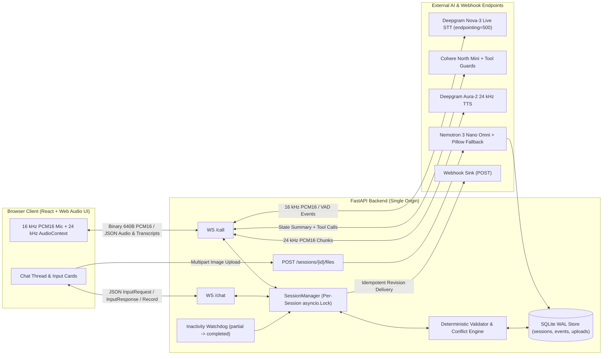

# Multichannel Voice + Chat Insurance Claims Agent

Full-duplex voice and web chat agent built for motor insurance claim intake. The system synchronizes state in real time across a browser voice call (`WS /call`) and an interactive chat thread (`WS /chat`), validates and normalizes inputs deterministically on the server, resolves cross-channel conflicts, and delivers an idempotent, revision-tracked `FinalRecord`.

* **Live Deployed URL:** [https://motor-claim-assistant-tanish.onrender.com](https://motor-claim-assistant-tanish.onrender.com)
* **Full-Session Demo Video:** [`Voice-Agent-Demo.mp4`](./Voice-Agent-Demo.mp4) — End-to-end screen recording on the live Render deployment showing a complete voice intake call (`WS /call`), non-clipping call handoff & auto-hangup into structured `/chat` cards, AI vision flagging an off-topic image into `needsReview` (`revision: 1`), and the final JSON record.
* **Sprint-Driven & TDD Architecture Spec:** [`SPRINT_PLAN.md`](./SPRINT_PLAN.md)

### Highlights & Brief Coverage (Core + Bonuses)

* **Core Full-Duplex Voice + Chat Pipeline:** Dual WebSockets (`WS /call` 16 kHz PCM16 in / 24 kHz PCM16 out with barge-in cancellation + `WS /chat` interactive cards), cross-channel sync & conflict resolution, SQLite `WAL` persistence across restarts, idempotent webhook delivery, and 4 server-authoritative outcomes (`completed`, `partial`, `optedOut`, `needsReview`).
* **Bonus — AI Vision Damage Photo Verification ([`vision.py`](backend/app/vision.py), [`main.py`](backend/app/main.py)):** Downscales uploaded photos (`MAX_IMAGE_DIM=512` JPEG), verifies vehicle damage via `nvidia/nemotron-3-nano-omni-30b-a3b-reasoning:free` (`reasoning={"effort": "none"}`), posts photo findings directly into `/chat`, and flags non-vehicle images (`state.vision_review_flag = True`) for human adjuster review while a Pillow fallback protects against upstream `429`/provider outages.
* **Bonus — Call Drop Recovery & Context-Aware Call Resume ([`session_manager.py`](backend/app/session_manager.py), [`voice.py`](backend/app/voice.py)):** Early disconnects post a smooth `/chat` transition and dispatch remaining cards; re-clicking **Call** runs `speak_context_greeting()` to recap collected SQLite fields and continue without repeating questions.
* **Bonus — Conversation Logging, Audit Timeline & Latency/Cost Telemetry ([`store.py`](backend/app/store.py), [`main.py`](backend/app/main.py)):** Per-turn `[TIMING]` logs (`llm_ms`, `tts_first_ms`, `tts_total_ms`, `audio_bytes`), `[EVENT=VISION_CHECK]` / `[EVENT=FINAL_RECORD_DELIVERED]` stdout banners, `GET /sessions/{sessionId}/timeline`, and `GET /sessions/{sessionId}/telemetry`.
* **Bonus — HTTP Testing Endpoints & Reviewer Reset UX:** Exposes `POST /api/sessions`, `POST /sessions/{sessionId}/files`, `GET /files/{sessionId}/{filename}`, `/timeline`, `/telemetry`, and `/api/webhook-sink`, plus a one-click **New chat** reset button ([`Header.tsx`](starter/src/components/header/Header.tsx)) and updated Motor Claim Assistant branding. *(Note: Language switching is not implemented; configured for English.)*
* **Verified Live Scenarios on Render (`https://motor-claim-assistant-tanish.onrender.com`):** I tested all three primary paths end-to-end — (1) non-vehicle upload flagged by AI vision $\rightarrow$ `needsReview`, (2) valid damage photo + `"none"` injuries $\rightarrow$ `completed`, and (3) valid damage photo + `"minor neck pain"` $\rightarrow$ `needsReview` (demo session `$0.0034` / `50s` call).

---

## 1. Architecture & Cross-Channel State Synchronization



### How State Is Shared Across Channels
Both `WS /call?sessionId={id}` and `WS /chat?sessionId={id}` attach to a single `SessionManager` backed by SQLite in Write-Ahead Logging (`WAL`) mode (`backend/app/store.py`). Every state read, validation, and write acquires a per-session `asyncio.Lock` and commits atomically to disk before emitting wire events:

1. **Call $\rightarrow$ Chat Sequenced Handoff:** While the user is on the voice call, the agent collects the 5 conversational fields (`incidentDescription`, `incidentLocation`, `incidentTime`, `injuries`, `vehicleDrivable`) via `record_spoken_fields`. `next_missing_input_request(call_active=True)` holds structured chat cards until all 5 spoken fields validate. Once captured, `VoicePipelineSession` enters `_closing_handoff`, drains the full goodbye audio buffer (`_last_tts_bytes / 48000.0 - _last_tts_play_elapsed_s + 1.5s`) before closing `/call`, and dispatches the structured chat cards (`policyNumber`, `vehicleType`, `email`, `damagePhotos`, `confirmSubmit`) one at a time.
2. **Chat $\rightarrow$ Call Live Acknowledgment:** If the user submits a chat card while `/call` is active, `handle_chat_message` validates and persists the value (`source="chat"`), dispatches the next card, and notifies the active `VoicePipelineSession`. If the voice agent is idle, it speaks an immediate confirmation; if mid-turn, it queues the acknowledgment to speak as soon as the current turn ends.
3. **Spoken Input Cancels Open Chat Card (`inputCancel`):** If an optional card (`email`) or `policyNumber` is open in `/chat` and the user speaks a valid value on `/call`, the backend saves it with `source="call"` and sends `{"type": "inputCancel", "requestId": "req_email", "reason": "given on the call"}` on `/chat`.
4. **Call Drop $\rightarrow$ Chat Fallback & Call Resume:** If `/call` disconnects early, `_nudge_chat_after_call` sends a transition message on `/chat` and dispatches input cards for all remaining spoken and chat fields. Re-clicking **Call** triggers `speak_context_greeting`, which summarizes already-collected fields from SQLite and resumes without repeating questions.
5. **LLM-Driven Flow With Deterministic Guardrails (`backend/app/voice.py`):** Rather than hardcoding a rigid script or trusting a free-tier LLM blindly, I kept the conversation LLM-driven (`cohere/north-mini-code:free`, `temperature=0.0`, 10-turn context) wrapped in narrow guards: `_parse_tool_args` repairs malformed tool JSON, `_is_spoken_field_grounded` blocks unmentioned field guesses, `_should_skip_call_update` supports progressive context refinement while preventing accidental shrinking, injury erasure, or unprompted time drift, and `_recover_direct_prompt_answer` catches terse `"Yes."` replies when the immediate `last_prompt` asked about `vehicleDrivable` or `injuries`.

---

## 2. Final Record Schema, Sanitization & Conflict Resolution

### Final Record JSON Schema
```json
{
  "sessionId": "s_7f3a",
  "revision": 1,
  "outcome": "completed | partial | optedOut | needsReview",
  "outcomeReason": "All required claim fields validated and confirmed by user",
  "fields": {
    "incidentDescription": {"value": "Rear-ended by a truck at a signal", "source": "call", "collectedAt": "2026-11-11T10:02:11+05:30", "status": "valid"},
    "incidentLocation": {"value": "MG Road, Bengaluru", "source": "call", "collectedAt": "2026-11-11T10:02:24+05:30", "status": "valid"},
    "incidentTime": {"value": "2026-11-11T08:00:00+05:30", "source": "call", "collectedAt": "2026-11-11T10:02:35+05:30", "status": "valid"},
    "injuries": {"value": "none", "source": "call", "collectedAt": "2026-11-11T10:02:48+05:30", "status": "valid"},
    "vehicleDrivable": {"value": true, "source": "call", "collectedAt": "2026-11-11T10:02:55+05:30", "status": "valid"},
    "policyNumber": {"value": "POL-123456", "source": "chat", "collectedAt": "2026-11-11T10:03:15+05:30", "status": "valid"},
    "vehicleType": {"value": "car", "source": "chat", "collectedAt": "2026-11-11T10:03:25+05:30", "status": "valid"},
    "email": {"value": "asha.rao@example.com", "source": "call", "collectedAt": "2026-11-11T10:03:40+05:30", "status": "valid"},
    "damagePhotos": {"value": ["http://localhost:8080/files/s_7f3a/d1.png"], "source": "chat", "collectedAt": "2026-11-11T10:04:02+05:30", "status": "valid"},
    "confirmSubmit": {"value": true, "source": "chat", "collectedAt": "2026-11-11T10:04:10+05:30", "status": "valid"}
  },
  "conflicts": [
    {
      "field": "policyNumber",
      "callValue": "POL-111111",
      "chatValue": "POL-123456",
      "resolution": "chatValue",
      "reason": "Typed or uploaded chat input preferred over spoken ASR transcript"
    }
  ],
  "engagement": {"calls": 1, "callSeconds": 118, "chatMessages": 5},
  "costUsd": 0.0038,
  "endedAt": "2026-11-11T10:04:10+05:30"
}
```

### Field Validation & Normalization Rules (`backend/app/validator.py`)

| # | Field | Primary Channel | Required | Normalization & Deterministic Validation Rule |
|---|---|---|---|---|
| 1 | `incidentDescription` | Call (or Chat fallback) | Yes | Collapse whitespace; valid if $\ge 10$ chars and $\ge 2$ words. |
| 2 | `incidentLocation` | Call (or Chat fallback) | Yes | Collapse whitespace; valid if $\ge 3$ chars. |
| 3 | `incidentTime` | Call (or Chat fallback) | Yes | Parses ISO-8601 or natural expressions (`"today at 9:30am"`, `"yesterday morning"`, `"2 hours ago"`) into `Asia/Kolkata` (`+05:30`) ISO-8601. Rejects future timestamps ($> \text{now} + 5\text{m}$) or $> 365$ days ago. |
| 4 | `injuries` | Call (or Chat fallback) | Yes | Normalizes `"no"`, `"none"`, `"nobody"`, `"no one hurt"` $\rightarrow$ `"none"`. Any other value $\ge 3$ chars is valid and sets `injury_review_flag = True`. |
| 5 | `vehicleDrivable` | Call (or Chat fallback) | Yes | Normalizes `"yes"`/`"true"`/`"drivable"` $\rightarrow$ `True`; `"no"`/`"false"`/`"not drivable"`/`"towed"` $\rightarrow$ `False`. |
| 6 | `policyNumber` | Chat Card | Yes | Uppercases, strips spaces, and normalizes prefix hyphen (`"pol 123456"` $\rightarrow$ `"POL-123456"`). Must match `^POL-[0-9]{6}$`. |
| 7 | `vehicleType` | Chat Card (`select`) | Yes | Case-insensitive match mapped to `car`, `twoWheeler`, or `commercial`. |
| 8 | `damagePhotos` | Chat Card (`file`) | Yes | 1–5 URLs verified to belong to this `sessionId` in `uploads` table (validated for PNG/JPEG/WEBP/GIF magic bytes $\le 10\text{ MB}$ + vision check). |
| 9 | `email` | Chat Card or Call | **Optional** | Lowercased; spoken `" at "` / `" dot "` normalized on `source="call"`. Validated against RFC email regex, or `"skip"` / `""` marks optional field handled (`value` omitted via `exclude_none=True`). |
| 10 | `confirmSubmit` | Chat Card (`confirm`) | Control | Dispatched only after fields 1–8 are valid. `True` finalizes session; `False` re-prompts once and triggers `optedOut` on second rejection. |

### Conflict Resolution Rules
When a field already has `status == "valid"` from `source_A` and receives a new valid value from `source_B` (`source_A != source_B`) where `normalized_new != existing_value`:
* **Structured Fields (`policyNumber`, `vehicleType`, `email`, `damagePhotos`):** `chatValue` always wins over `callValue` (`resolution="chatValue"`), preventing ASR errors on alphanumeric strings.
* **Conversational Fields (`incidentDescription`, `incidentLocation`, `incidentTime`, `injuries`, `vehicleDrivable`):** Latest valid update wins, allowing the user to refine or correct their statement in a later turn.
* All conflicts are logged in `state.conflicts` with `field`, `callValue`, `chatValue`, `resolution`, and `reason`. Any uncollected required field is explicitly included in `FinalRecord.fields` with `status: "missing"` or `"invalid"`.

---

## 3. Outcome Triggers, Delivery & Revision Lifecycle

| Outcome | Trigger Condition |
|---|---|
| **`completed`** | All 8 required fields have `status == "valid"`, `confirmSubmit == True`, and no `needsReview` flag is active. |
| **`partial`** | `/call` is disconnected and no `/chat` activity occurs for `PARTIAL_TIMEOUT_SECONDS` (default `120s`) while at least one required field is missing/invalid or unconfirmed. |
| **`optedOut`** | User explicitly cancels on the call (`opt_out_session` tool), submits `"cancel claim"` / `"opt out"`, or rejects `confirmSubmit` (`False`) twice. |
| **`needsReview`** | Triggered if: (a) any field fails validation $\ge 3$ consecutive times, (b) `injuries != "none"` upon final confirmation (bodily injury requires human adjuster review), or (c) an uploaded damage photo fails AI vision vehicle-damage verification (`state.vision_review_flag = True` on upload in `main.py`; `vision.py` also provides the 2-strike `validate_upload_and_update` helper). |

### Delivery & Revision Upgrades (`revision: 1 -> 2`)
* Sessions start at `revision = 0`, `delivered_revision = 0`.
* Reaching any outcome increments `revision += 1`, persists `FinalRecord` to SQLite, sends `{"type": "record", "record": ...}` over `/chat`, and calls `deliver_final_record()` (`backend/app/webhook.py`).
* `deliver_final_record()` checks `state.delivered_revision < record.revision`, logs the JSON record to stdout, POSTs to `WEBHOOK_URL` (and `/api/webhook-sink`), and atomically updates `delivered_revision = record.revision`. Server restarts never re-deliver an already delivered revision.
* **Resuming a `partial` Session:** If the inactivity watchdog emits `outcome="partial"` (`revision: 1`) and the user later returns to finish the remaining fields and confirm, the session transitions to `completed` (or `needsReview`), increments to `revision: 2`, and delivers the updated record.

---

## 4. Stack Choice & Session Cost ($\le 150$ Words)

I built the backend with Python FastAPI and SQLite (`WAL` mode), pairing Deepgram Nova-3 (`endpointing=500`) for 16 kHz streaming STT, Deepgram Aura-2 (`aura-2-thalia-en`) for 24 kHz streaming PCM16 TTS, OpenRouter (`cohere/north-mini-code:free`) for tool-calling voice turns, and `nvidia/nemotron-3-nano-omni-30b-a3b-reasoning:free` (`effort="none"`, `MAX_IMAGE_DIM=512`) with a Pillow fallback for damage-photo verification. Passing raw PCM16 frames directly between the browser and Deepgram avoids server-side audio transcoding and keeps barge-in cancellation immediate.

My out-of-pocket spend was **$0.00** using Deepgram free credits and OpenRouter `:free` models. Across verified 49–63s live calls, `state.cost_usd` tracked **$0.0034–$0.0040 per session**, while a full 2-minute call (90s speech, 600 TTS chars) at standard list rates costs **~$0.0155** ($0.0065 STT + $0.0090 TTS + $0.00 `:free` LLM/Vision).

*(113 words)*

---

## 5. Product Decisions Where the Brief Was Vague

1. **Collecting Full Context Before Escalating Bodily Injury (`needsReview`):** When a caller reports an injury (`injuries != "none"`), aborting the call immediately would force a human adjuster to cold-call them for basic policy and vehicle details. Instead, I set `injury_review_flag = True`, collect all 8 required fields + confirmation, post a clear explanation note in `/chat`, and route the complete claim packet to `needsReview`.
2. **Holding Chat Cards Until Spoken Fields Finish:** Rather than distracting a caller by dropping 4 chat cards onto the screen at second zero, I hold structured chat cards while the 5 conversational fields are collected by voice, then play the closing handoff before dispatching chat cards one by one.
3. **Bypassing Browser Regex Blocking for Server-Side 3-Strike Escalation:** Inspecting `starter/src/components/cards/Composer.tsx` and `answers.ts` revealed that setting `InputRequest.pattern` causes the browser to block invalid strings locally before sending them over `/chat`. I intentionally omit `pattern` on server-dispatched requests so invalid inputs (e.g., `"POL-123"`) reach FastAPI for deterministic validation, `inputError` card re-opening, and 3-strike `needsReview` escalation.
4. **Actionable Vision Feedback in Chat:** When a user uploads a damage photo, I configured the vision model to post a short damage assessment message into `/chat` (and flag suspicious uploads for adjuster review without blocking the upload flow).
5. **120-Second `partial` Timeout:** Configured via `PARTIAL_TIMEOUT_SECONDS=120` so evaluators can test the `partial` (`revision: 1`) $\rightarrow$ `completed` (`revision: 2`) upgrade without waiting 30 minutes.

---

## 6. Edge Cases Handled vs. Known Limitations

### Edge Cases Handled
* **Server Restart Mid-Session:** All fields, open card specs (`open_request`), failure counts, and revision watermarks persist in SQLite WAL. Restarting `uvicorn` and refreshing resumes on the exact open field without repeating questions or double-sending webhooks.
* **Non-Clipping Call Handoff:** `_finish_call_after_speech` calculates remaining client audio playback duration from streamed 24 kHz PCM bytes (`_last_tts_bytes / 48000.0 - _last_tts_play_elapsed_s + 1.5s`) before closing `/call` so the goodbye message never clips mid-sentence.
* **Mid-Sentence Barge-In:** Deepgram `SpeechStarted` events cancel active non-closing TTS tasks and emit `{"type": "stopPlayback"}` on `/call` to flush browser playback buffers immediately.
* **Small-Model Tool Quirks & Guarded Progressive Refinement:** `_parse_tool_args` repairs malformed JSON commas/brackets, `_is_spoken_field_grounded` prevents hallucinated defaults, `_should_skip_call_update` lets callers elaborate or revise spoken details naturally across turns while blocking description truncation, injury erasure, and time drift, and `_recover_direct_prompt_answer` captures short `"Yes."` responses to direct questions.
* **Fake Image Uploads & Upstream Vision 429s:** `POST /sessions/{id}/files` checks PNG/JPEG/WEBP/GIF magic bytes before writing to disk, downscales to `512px` JPEG for fast vision checks, and falls back to local Pillow verification on upstream `HTTP 429` or timeouts.

### Known Limitations
* **Single-Node Process Locks & Rate Limiter:** Per-session `asyncio.Lock` instances and the sliding-window rate limiter live in process memory (`--workers 1`). Multi-replica horizontal scaling would require Redis.
* **Heuristic Relative Date Parser:** `_parse_incident_time()` handles ISO dates and common relative phrases (`"today at 4pm"`, `"yesterday morning"`, `"2 hours ago"`), but complex regional phrasing (*"the Tuesday before last"*) requires clarification or chat fallback.
* **English-Only ASR/TTS:** Configured for English (`nova-3`, `aura-2-thalia-en`); mid-call language switching is not enabled in this build.

---

## 7. What in My System I Trust Least (and Why)

1. **Free-Tier LLM Router Queue Jitter & Dropped Tool Calls (`backend/app/voice.py`):**
   * *Why:* Public `:free` OpenRouter queues experience variable load. Live testing showed `nvidia/nemotron-3.5-lightning:free` suffered reasoning stalls or dropped tool calls, and while `cohere/north-mini-code:free` is much faster (~0.7–1.9s observed), it can still hit occasional router queue spikes or skip a tool call on a single-word `"Yes."` reply.
   * *Mitigation:* I added pooled keep-alive HTTP connections, `_parse_tool_args`, `_is_spoken_field_grounded`, and question-reactive `_recover_direct_prompt_answer` so state updates remain reliable.
2. **VAD Sensitivity Without Headphones (`backend/app/voice.py`):**
   * *Why:* Deepgram `SpeechStarted` fires quickly to keep barge-in responsive, which means speakerphone echo or a loud cough in a noisy room can trigger a false interruption.
   * *Mitigation:* I disable barge-in during `_closing_handoff` and keep the full text of any interrupted turn visible in the live transcript.
3. **Regex-Based Natural Time Normalization (`backend/app/validator.py`):**
   * *Why:* Unconstrained spoken time expressions that fall outside `_parse_incident_time()` patterns trigger a re-prompt and increment `failure_counts`.

---

## 8. Voice Latency & Cost Measurements

### Empirical Latency (`p50` and `p95`)
I measured end-to-end turn latency in `VoicePipelineSession` (`backend/app/voice.py`) from the timestamp Deepgram finalizes user speech (`_t_user_speech_end` in `_handle_final_transcript`) to the first 24 kHz PCM16 `AudioMessage` chunk sent to `/call` (`t_first_sent`), recorded across **17 conversational turns** over 3 live end-to-end voice + chat calls (`sessions.db`, excluding the initial `0.0 ms` greeting):

| Metric | Observed Measurement | Notes / Scope |
|---|---|---|
| **Voice Turn Latency `p50` (`_t_user_speech_end` $\rightarrow$ `t_first_sent`)** | **2,142 ms** | Across 17 live turns (range `1,151 ms` – `3,949 ms`) |
| **Voice Turn Latency `p95`** | **2,964 ms** (`3,949 ms` max) | Driven by shared queue spikes on OpenRouter `:free` |
| **LLM Inference (`cohere/north-mini-code:free`)** | **724 – 1,908 ms** | Per-turn `[TIMING]` logs (`llm_ms`) |
| **Deepgram Aura-2 TTS First Chunk (`aura-2-thalia-en`)** | **372 – 920 ms** | Per-turn `[TIMING]` logs (`tts_first_ms`) |
| **Vision Photo Check (`nvidia/nemotron-3-nano-omni-30b-a3b-reasoning:free`)** | **1,939 ms** (`679 ms` negative) | `MAX_IMAGE_DIM=512`, JPEG, `reasoning={"effort": "none"}` |
| **Offline Automated Test Suite (`pytest backend/tests/ -v`)** | **71 passed** | Deterministic mock STT/LLM/TTS + Pillow fallback |

*(Note: Including Deepgram's `endpointing=500` silence window puts perceived turn latency slightly higher on shared free tiers; swapping `LLM_BASE_URL` / `LLM_MODEL` in `.env` to a paid Groq or dedicated OpenRouter endpoint removes shared-queue spikes with zero code changes.)*

### Cost Breakdown
Tracked per session in `state.cost_usd` (`GET /sessions/{sessionId}/telemetry`):
* **Actual Out-of-Pocket Spend:** **`$0.00`** (OpenRouter `:free` models + Deepgram free-tier credits).
* **Tracked Live Session Cost (`49s–63s` calls):** **`$0.0034–$0.0040`** per session.
* **2-Minute Session List-Rate Ceiling (90s speech, 600 TTS chars):** **~$0.0155** (`$0.0065` Nova-3 STT at $0.0043/min + `$0.0090` Aura-2 TTS at $0.015/1K chars + `$0.00` `:free` LLM/Vision).

---

## 9. What I Would Do Next With Another Week

I built this working, non-rigid prototype in **~1.5 days** using only free-tier APIs and models (`$0.00` out-of-pocket spend), so I can harden it further for stability, lower latency, and user experience going forward:

1. **Dedicated Low-Latency Inference Endpoints:** Move off shared `:free` queues onto dedicated Groq / low-latency endpoints to bring voice turn `p95` reliably under `1,000 ms`.
2. **Token-Level Sentence Streaming into WebSocket TTS:** Stream LLM text tokens through a sentence buffer directly into Deepgram's WebSocket TTS API to cut another ~200–400 ms before the first audio byte.
3. **Inline Chat Field Editing:** Allow users to click and edit any previously captured field directly in the chat thread rather than phrasing spoken corrections.
4. **Acoustic Barge-In Debouncing:** Require $\ge 150\text{ ms}$ of sustained VAD speech energy or a non-empty interim word token before firing `stopPlayback`.
5. **Multilingual Switching & Redis State:** Add English/Hindi/regional language switching and move session locks/rate limits to Redis for multi-worker scaling.

---

## 10. How I Used AI Tools: Sprint-Driven & Test-Driven Agentic Development

Rather than prompting an AI coding assistant to generate the entire application in one shot—which typically produces fragile WebSocket state and subtle protocol mismatches—I drove the build using a strict **Contract-First, Sprint-Driven Development (SDD)** and **Test-Driven Development (TDD)** workflow anchored in [`SPRINT_PLAN.md`](./SPRINT_PLAN.md):

1. **Phase 0 — Ground-Truth Protocol Audit (No Code Generation):** Before writing any backend code, I audited the `starter/src/` protocol, transport, audio, hook, and card modules and locked the wire contracts in [`SPRINT_PLAN.md`](./SPRINT_PLAN.md). Keeping `starter/` unmodified throughout Sprints 1–5 backend development uncovered crucial requirements up front: the dual-WebSocket split (`WS /chat` + `WS /call`), the asymmetric audio format (raw 640-byte 16 kHz PCM16 binary frames in vs. base64 24 kHz JSON packets out), `POST /sessions/{id}/files`, and omitting `InputRequest.pattern` so browser regex checks wouldn't silently block invalid inputs (`"POL-123"`) from testing server-side `inputError` and 3-strike escalation. *(After all 5 backend sprints passed, I made only targeted UI additions in `starter/src/` for branding and a one-click **New chat** reset button.)*
2. **5-Sprint TDD Execution with Offline Mock Gates ([`SPRINT_PLAN.md`](./SPRINT_PLAN.md)):** I broke the backend into 5 isolated sprints, each gated by an automated `pytest` suite (`test_sprint1.py` through `test_sprint5.py`, 71 tests total) using deterministic `MockSTTProvider`, `MockLLMProvider`, and `MockTTSProvider` harnesses:
   * *Sprint 1 (`test_sprint1.py`):* Pydantic v2 wire schemas, deterministic validators, conflict resolution matrix, and SQLite WAL persistence.
   * *Sprint 2 (`test_sprint2.py`):* `/chat` WebSocket loop, magic-byte file uploads, idempotent webhook delivery, and server restart recovery.
   * *Sprint 3 (`test_sprint3.py`):* `/call` full-duplex audio pipeline and immediate asyncio-task barge-in cancellation (`stopPlayback`).
   * *Sprint 4 (`test_sprint4.py`):* Cross-channel state sync (`inputCancel`, chat-to-call acknowledgments, call drop fallback, and `partial` $\rightarrow$ `completed` revision upgrades).
   * *Sprint 5 (`test_sprint5.py`):* Vision photo verification, sliding-window rate limiting, single-container Docker packaging, and spoken-refinement regression tests (after Sprint 5, my live free-tier benchmarking refined model defaults from Groq/Nemotron-VL targets to `cohere/north-mini-code:free` + `nvidia/nemotron-3-nano-omni-30b-a3b-reasoning:free`).

### Where AI Helped vs. Where It Misled Me
* **Where AI Helped:**
  * Converting `starter/src/` TypeScript interfaces into strict Pydantic v2 models (`by_alias=True, exclude_none=True`) and rapidly scaffolding parameterized `pytest` unit/integration tests across all 5 sprints.
  * I fed real browser voice and Render console traces (`[TIMING]`, Deepgram close codes, and vision responses) to iterate quickly on surgical fixes — pooled HTTP keep-alive clients, non-clipping TTS handoff waits (`_finish_call_after_speech`), and narrow grounding/recovery guards (`_is_spoken_field_grounded`, `_recover_direct_prompt_answer`) that keep my voice flow flexible rather than brittle.
* **Where AI Suggestions Misled or Broke Live Behavior (and How I Caught & Fixed Them):**
  1. **`VITE_SERVER_URL=""` Empty-String Trap in Docker Planning:** For single-origin Docker builds, an initial draft suggested `VITE_SERVER_URL="" npm run build`. When I inspected [`starter/src/config.ts`](starter/src/config.ts#L10-L11) (`if (!raw) return null;`) before building, I caught that an empty string displays the *"No backend configured"* error banner. Instead, I configured [`Dockerfile`](Dockerfile) to build with placeholder `https://__RUNTIME_SERVER_HOST__` and [`docker/entrypoint.sh`](docker/entrypoint.sh) to substitute `${PUBLIC_URL}` at container boot.
  2. **Un-Locked Deepgram WebSocket Connection Storm (`ConcurrencyError` / `net0001`):** Initial `DeepgramLiveSTT.ingest()` code lacked locking around lazy WebSocket setup. On my first live microphone test, rapid 20 ms PCM16 frames raced into `_connect()`, triggering 20+ concurrent Deepgram sockets (`ConcurrencyError`), while quiet chat phases timed out (`net0001`). Diagnosing those live logs led me to add double-checked `_connect_lock` + `_send_lock` guards and a 5-second `KeepAlive` loop.
  3. **Overlapping Chat/Call Prompts, `callSeconds: 0`, Clipped Goodbye Hangup & False Opt-Out:** Early cross-channel integration leaked structured cards and duplicate prompts during active calls, left `engagement.callSeconds` at `0` in terminal records before close sync, and initially closed `/call` mid-sentence before streamed TTS goodbye audio finished playing (plus asking *"Can I end the call?"* triggered `opt_out_session`). Testing live browser calls surfaced each regression, so I implemented clean stage separation (`_closing_handoff`), playback-duration calculation (`_finish_call_after_speech`), `_elapsed_call_seconds`, and tighter system prompt boundaries.
  4. **Free-Tier Reasoning & Vision Latency Traps (`nemotron-3.5` vs. `cohere` + `nano-omni`):** Offline mocks gave false confidence that `:free` OpenRouter reasoning models would invoke tools cleanly once thinking was suppressed. My live tests proved `nvidia/nemotron-3.5-lightning:free` either added router latency spikes or dropped `record_spoken_fields` tool calls (skipping `injuries` / `vehicleDrivable` or looping 3x on `vehicleDrivable`), while full-resolution uploads to `nvidia/nemotron-3.5-super-vl:free` stalled and emitted `<think>` tags. After live benchmarking, I switched to `cohere/north-mini-code:free` + narrow grounding/recovery guards for voice and `nvidia/nemotron-3-nano-omni-30b-a3b-reasoning:free` (`512px` JPEG resize, `reasoning={"effort": "none"}`, regex JSON extraction, and Pillow fallback) for vision.
  5. **Over-Strict Spoken Field Lock Freezing Partial Context (`voice.py`):** While stopping small-model overwrites, AI-suggested guardrails introduced a rigid `"collected (do not overwrite)"` lock in [`_tool_record_spoken_fields`](backend/app/voice.py) that blocked updates to already-valid `CALL` fields unless `last_prompt` matched that exact field or the caller used cue words like `"actually"` or `"sorry"`. Reviewing my multi-question opener (*"what happened, where, and when?"*), I suspected callers could give a short initial answer and add detail naturally across turns—or reveal pain later after saying `"none"`. I checked this hypothesis with a 5-scenario synthetic dataset against live `cohere/north-mini-code:free` and verified that AI's hard lock froze brief descriptions as `"car accident"` and left delayed injury disclosures stuck on `"none"` (`injury_review_flag=False`). I intervened to replace the hard lock with guarded progressive refinement ([`_should_skip_call_update`](backend/app/voice.py)), allowing natural elaboration and late safety updates while preserving ungrounded-field blocking, time-drift stability, and non-degradation checks across offline regression tests.

---

## 11. Local Setup, Docker & Testing Endpoints

### Run Locally
```bash
# 1. Backend setup (from repository root)
python3 -m venv .venv && source .venv/bin/activate
pip install -r backend/requirements.txt
cp backend/.env.example backend/.env
# Add DEEPGRAM_API_KEY and OPENROUTER_API_KEY to backend/.env
PYTHONPATH=. uvicorn backend.app.main:app --host 0.0.0.0 --port 8080 --env-file backend/.env

# 2. Frontend build (single-origin served by FastAPI at http://localhost:8080)
cd starter
npm install
VITE_SERVER_URL=http://localhost:8080 npm run build

# Or run Vite dev server separately in a second terminal:
cp .env.example .env.local   # Sets VITE_SERVER_URL=http://localhost:8080
npm run dev                  # Open http://localhost:5173
```

### Run via Single-Container Docker
```bash
docker build -t voice-chat-agent .
docker run --rm -p 8080:8080 \
  -e PUBLIC_URL=http://localhost:8080 \
  -e BASE_URL=http://localhost:8080 \
  -e DEEPGRAM_API_KEY=your_key \
  -e OPENROUTER_API_KEY=your_key \
  -e LLM_MODEL=cohere/north-mini-code:free \
  -e VISION_MODEL=nvidia/nemotron-3-nano-omni-30b-a3b-reasoning:free \
  voice-chat-agent
```

### Run Automated Test Suite (71 Tests, Offline)
```bash
python -m pytest backend/tests/ -v
```

### HTTP Inspection & Testing Endpoints
* `POST /api/sessions` — Create a new session (`{"session_id": "..."}`).
* `POST /sessions/{sessionId}/files` — Upload a damage photo (`multipart/form-data`, `file`).
* `GET /sessions/{sessionId}/timeline` — Chronological audit log across `call`, `chat` (including `vision_check` events), and `system` channels.
* `GET /sessions/{sessionId}/telemetry` — Session `p50_latency_ms`, `p95_latency_ms`, `cost_usd`, and engagement counters.
* `POST /api/webhook-sink`, `GET /api/webhook-sink`, `DELETE /api/webhook-sink` — Built-in sink to deliver, inspect, and reset captured `FinalRecord` revisions.